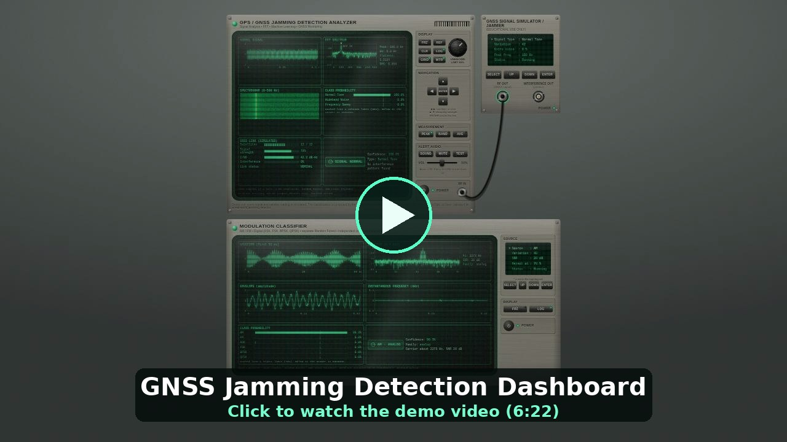
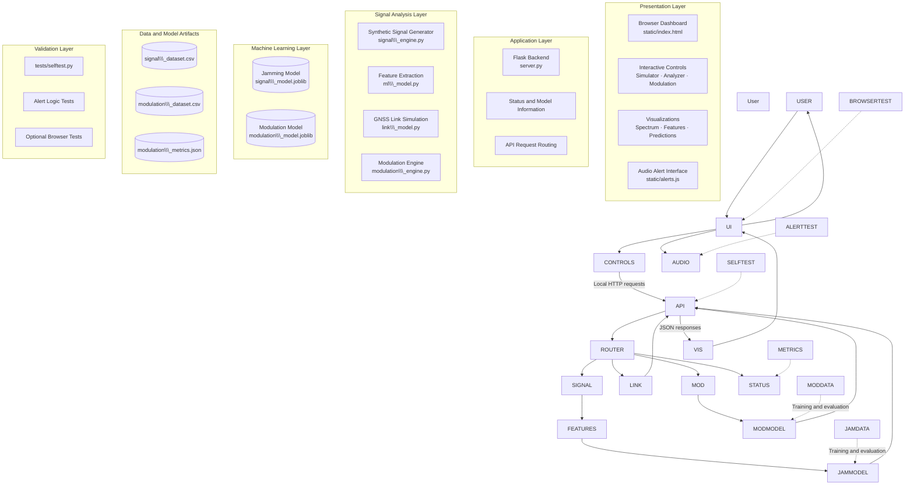
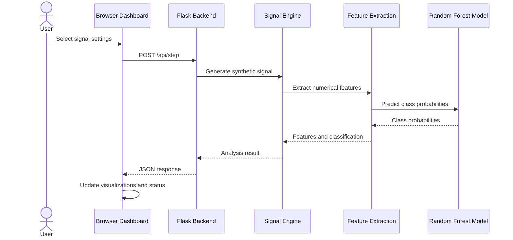
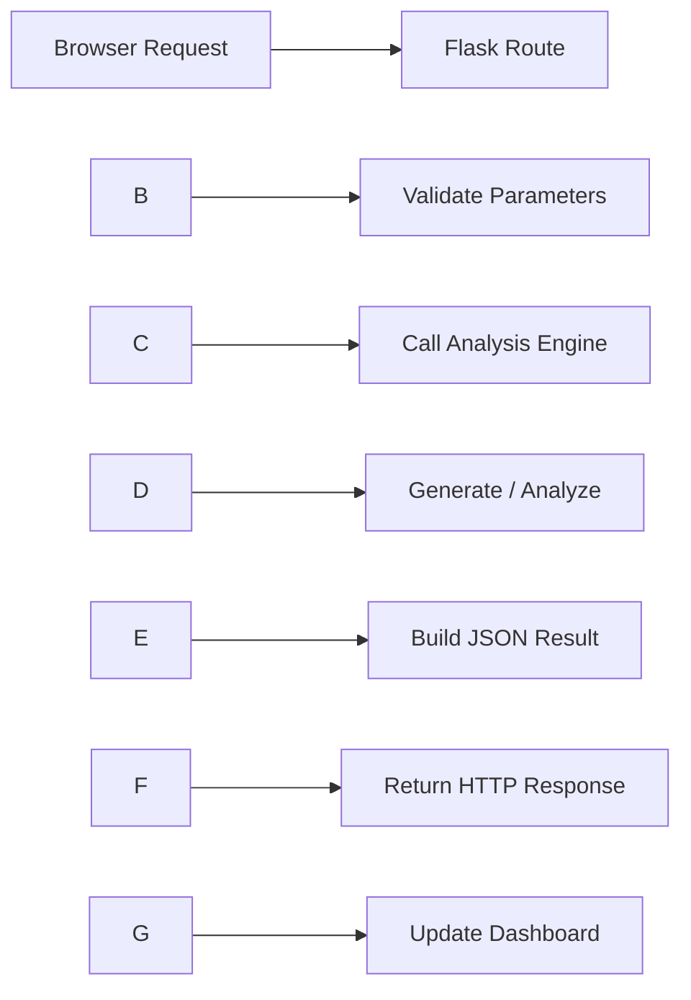

[](https://youtu.be/DWnpqoYeaOM)

# GNSS Jamming Detection Analyzer

## System Architecture and Technical Documentation

**Project:** GNSS Jamming Detection Analyzer  
**Application type:** Local simulation and signal-analysis dashboard  
**Frontend:** HTML, CSS, JavaScript  
**Backend:** Python, Flask  
**Machine Learning:** Scikit-learn Random Forest  
**Signal Processing:** NumPy and SciPy  
**Deployment:** Local Windows computer  
**Operating mode:** Synthetic data simulation

\---

# Table of Contents

1. Project Overview
2. Objectives and Scope
3. System Requirements
4. System Architecture
5. Architecture Layers
6. Project Directory Structure
7. Component Descriptions
8. End-to-End Data Flow
9. Signal Generation and Processing
10. Feature Extraction
11. Jamming Classification
12. Simulated GNSS Link Model
13. Modulation Classification
14. Audio Alert System
15. API Architecture
16. Frontend Dashboard
17. Machine Learning Artifacts
18. Installation and Execution
19. Testing and Validation
20. Performance Evaluation
21. Security and Reliability
22. Limitations
23. Future Enhancements
24. Glossary
25. Conclusion

\---

# 1\. Project Overview

The GNSS Jamming Detection Analyzer is a locally hosted software application that demonstrates the analysis and classification of synthetic radio signals.

The application provides a mission-control-style dashboard where users can manipulate simulated signal parameters, inspect frequency-domain visualizations, observe machine-learning predictions, monitor an illustrative GNSS link, and identify simulated modulation types.

The application combines:

* A browser-based dashboard.
* A Python Flask backend.
* Synthetic signal generation.
* Digital signal-processing techniques.
* Two independent Random Forest classifiers.
* A simulated GNSS link model.
* An optional browser audio-alert system.
* Automated software tests.

The browser is responsible for presenting information and collecting user interactions. The Python backend performs the signal-processing and classification operations.

The project operates locally and is designed primarily for demonstration, learning, and experimentation.

> \\\*\\\*Important limitation:\\\*\\\* All signals, satellite readings, and link measurements in this project are simulated. The system is not connected to a physical GNSS receiver and has not been validated as a real-world GNSS jamming detector.

## 1.1 Main Functional Modules

The application contains three primary analysis modules.

### Module A: Jamming Signal Analyzer

Generates synthetic signals and classifies them into three trained categories:

* Normal Tone
* Wideband Noise
* Frequency Sweep

The application extracts signal features and passes them to a saved Random Forest model.

A configurable confidence threshold can cause the system to return `UNKNOWN` when the maximum predicted class probability is too low.

### Module B: Simulated GNSS Link Monitor

Calculates illustrative satellite counts, signal strength, and link status using a simplified simulation.

This module demonstrates how interference scenarios might be represented visually in a monitoring interface.

Its outputs are simulated values, not actual GNSS receiver measurements.

### Module C: Modulation Classifier

Uses a separate machine-learning model to classify six simulated modulation types:

**Analog modulation**

* AM — Amplitude Modulation
* FM — Frequency Modulation

**Digital modulation**

* ASK — Amplitude Shift Keying
* FSK — Frequency Shift Keying
* BPSK — Binary Phase Shift Keying
* QPSK — Quadrature Phase Shift Keying

The modulation classifier has its own training dataset, model artifact, and evaluation metrics.

\---

# 2\. Objectives and Scope

## 2.1 Project Objectives

1. Demonstrate synthetic radio-signal generation.
2. Visualize signals in the time and frequency domains.
3. Extract meaningful numerical signal features.
4. Apply a trained Random Forest classifier.
5. Demonstrate confidence-based rejection through an `UNKNOWN` state.
6. Simulate changes in GNSS link conditions.
7. Recognize selected analog and digital modulation categories.
8. Provide audio alerts for selected simulated events.
9. Build an interactive, locally hosted dashboard.
10. Validate important application behaviors through automated tests.

## 2.2 Scope

The application is a software simulation.

It does not currently demonstrate verified detection of actual GNSS interference, spoofing, or satellite-navigation failure.

Its reported accuracy values describe performance on synthetic datasets and must not be interpreted as real-world detection accuracy.

\---

# 3\. System Requirements

## 3.1 Software Requirements

|Component|Requirement|
|-|-|
|Operating system|Windows 10 or Windows 11|
|Python|Python 3.13, as specified by the project|
|Backend framework|Flask|
|Numerical processing|NumPy|
|Signal processing|SciPy|
|Machine learning|Scikit-learn|
|Model serialization|Joblib|
|Optional plotting utility|Matplotlib|
|Browser|Chrome or Microsoft Edge|
|Optional browser testing|Playwright|
|Optional alert-logic testing|Node.js|

The project includes a `requirements.txt` file with pinned dependency versions. Use those versions when setting up the environment.

## 3.2 Runtime Environment

The intended local address is:

`http://127.0.0.1:5000`

The application can use a different port through the `GNSS\\\_PORT` environment variable.

The local Flask server is intended to listen on the loopback interface rather than expose itself to the public internet.

\---

# 4\. System Architecture

## 4.1 High-Level Architecture Diagram

The following diagram illustrates the main system components, their relationships, and the direction of information flow.



## 4.2 Architecture Explanation

### Presentation Layer

The browser presents the dashboard and accepts user interactions.

It displays the generated signal, spectrum, classification, feature values, link status, modulation results, and alert controls.

### Application Layer

The Flask backend receives HTTP requests, selects the appropriate processing component, and returns results in JSON format.

### Signal Analysis Layer

The signal-processing components generate synthetic samples, extract features, calculate simulated link conditions, and prepare inputs for machine-learning inference.

### Machine Learning Layer

Two independent saved Random Forest models are used:

* `signal\\\_model.joblib`
* `modulation\\\_model.joblib`

The first model performs the documented jamming-demo classification. The second performs modulation classification.

### Data and Artifact Layer

CSV datasets support model training and evaluation. The modulation metrics JSON file stores evaluation information.

### Validation Layer

Automated tests check important application behavior, including model loading, simulated link calculations, classification behavior, and audio-alert logic.

\---

# 5\. Architecture Layers

|Layer|Main responsibility|Main components|
|-|-|-|
|User interface|Display data and collect controls|HTML, CSS, JavaScript|
|HTTP communication|Exchange requests and responses|Local HTTP, JSON|
|Backend application|Route requests and coordinate operations|`server.py`|
|Signal processing|Generate and analyze signals|NumPy, SciPy, signal engine|
|Jamming inference|Classify synthetic signal features|Scikit-learn, jamming model|
|Link simulation|Calculate illustrative link status|`link\\\_model.py`|
|Modulation inference|Recognize simulated modulation types|Modulation engine and model|
|Alert handling|Manage optional audio notifications|`alerts.js`|
|Validation|Test components and expected behavior|Python tests and optional browser tests|

\---

# 6\. Project Directory Structure

The following structure is documented for the supplied project.

```text
gnss\\\_dashboard/
│
├── run\\\_dashboard.bat
├── run\\\_selftest.bat
├── run\\\_signal\\\_simulator.bat
├── retrain\\\_model.bat
├── retrain\\\_modulation.bat
├── setup\\\_env.bat
├── requirements.txt
│
├── server.py
├── signal\\\_engine.py
├── link\\\_model.py
├── modulation\\\_engine.py
├── train\\\_modulation.py
│
├── ml\\\_model.py
├── signal\\\_model.joblib
├── signal\\\_dataset.csv
├── signal\\\_simulator.py
│
├── modulation\\\_model.joblib
├── modulation\\\_dataset.csv
├── modulation\\\_metrics.json
│
├── static/
│   ├── index.html
│   ├── alerts.js
│   └── audio/
│       └── jammer\\\_alert.mp3
│
├── tests/
│   ├── selftest.py
│   ├── test\\\_alert\\\_gate.js
│   └── browser\\\_test.py
│
└── app.py
```

## 6.1 Important Files

|File|Purpose|
|-|-|
|`server.py`|Main Flask backend and API routes|
|`signal\\\_engine.py`|Synthetic signal generation and jamming-analysis coordination|
|`ml\\\_model.py`|Jamming-model feature extraction and classification functions|
|`signal\\\_model.joblib`|Saved jamming-demo Random Forest|
|`link\\\_model.py`|Simulated GNSS link calculations|
|`modulation\\\_engine.py`|Synthetic modulation generation and classifier wrapper|
|`train\\\_modulation.py`|Generates training data and trains/evaluates the modulation model|
|`modulation\\\_model.joblib`|Saved modulation classifier|
|`modulation\\\_dataset.csv`|Synthetic modulation dataset|
|`modulation\\\_metrics.json`|Modulation evaluation results|
|`static/index.html`|Browser dashboard|
|`static/alerts.js`|Audio playback and duplicate-alert prevention|
|`tests/selftest.py`|Main automated validation script|
|`app.py`|Existing Streamlit application, documented as separate from the main dashboard|

\---

# 7\. Component Descriptions

## 7.1 Flask Backend

**File:** `server.py`

The Flask backend is the central application component.

Responsibilities include:

* Serving the dashboard.
* Receiving HTTP requests.
* Validating and processing request parameters.
* Calling signal-processing engines.
* Invoking the saved machine-learning models through their wrappers.
* Returning JSON responses.
* Providing model and application status information.

The documented routes include `/api/status`, `/api/step`, `/api/classify`, `/api/link`, and modulation-related routes under `/api/mod/\\\*`.

The exact HTTP methods and schemas for the link and modulation routes must be confirmed in the actual implementation.

## 7.2 Signal Engine

**File:** `signal\\\_engine.py`

The signal engine coordinates synthetic signal generation and jamming analysis.

It receives configuration values such as signal type, variation or seed, and additional noise.

It then prepares signal samples and coordinates feature extraction and classification.

## 7.3 Feature Extraction

**File:** `ml\\\_model.py`

The feature-extraction functions transform generated samples into a numerical feature vector.

The documented feature vector contains:

1. Peak frequency
2. Bandwidth
3. Spectral flatness
4. RMS amplitude

These features are passed to the saved jamming model.

## 7.4 GNSS Link Model

**File:** `link\\\_model.py`

This component simulates the effect of signal scenarios on illustrative link indicators.

Its documented responsibilities include calculating satellite count, signal strength, C/N0-like values, and status.

It does not measure a physical GNSS link.

## 7.5 Modulation Engine

**File:** `modulation\\\_engine.py`

This module provides the separate modulation-classification workflow.

It supports synthetic AM, FM, ASK, FSK, BPSK, and QPSK examples and uses a separate saved model.

## 7.6 Audio Alert Engine

**File:** `static/alerts.js`

This browser-side component manages optional alert playback.

It handles event qualification, duplicate prevention, cooldown behavior, alert priority, and sound playback.

The browser requires an initial user gesture before audio playback is permitted.

\---

# 8\. End-to-End Data Flow

## 8.1 Jamming Analysis



### Step-by-step explanation

1. The user chooses a signal type and configuration.
2. The browser sends the settings to the Flask backend.
3. The backend generates the corresponding synthetic signal.
4. The signal is processed to extract the configured features.
5. The saved Random Forest predicts the class probabilities.
6. A confidence threshold determines whether the prediction is accepted or rejected as `UNKNOWN`.
7. The backend returns the analysis result.
8. The dashboard updates its visualizations and status indicators.

The display can use recent frames for smoothing, while the alert system uses an instantaneous decision.

## 8.2 Simulated Link Flow

1. The user changes the simulated link controls or signal scenario.
2. The backend receives the updated state.
3. `link\\\_model.py` calculates illustrative link indicators.
4. The backend returns the resulting values.
5. The dashboard updates the simulated GNSS link panel.

The link calculation is rule-based and illustrative. It is not a trained-model prediction.

## 8.3 Modulation Classification Flow

1. The user selects a modulation scenario and its parameters.
2. The frontend sends the request to the backend.
3. The modulation engine generates a synthetic signal.
4. The model receives the required extracted features.
5. The modulation Random Forest predicts one of its trained classes, subject to the rejection rule.
6. The frontend displays the result.

\---

# 9\. Signal Generation and Processing

## 9.1 Signal Types

The jamming-demo analyzer documents four selectable scenarios:

|Scenario|Purpose|
|-|-|
|Normal Tone|Represents the configured normal class|
|Wideband Noise|Represents a simulated noise-like interference class|
|Frequency Sweep|Represents a simulated frequency-varying interference class|
|Unfamiliar Test Signal|Demonstrates confidence-based rejection behavior|

The first three are the documented trained categories. The unfamiliar test signal is an input scenario, not a fourth documented trained class.

## 9.2 Signal Parameters

The documented simulator controls include:

* Signal type.
* Variation or seed.
* Additional noise level.
* Running/stopped state.

These parameters control the synthetic signal rather than an actual transmitted or received RF signal.

## 9.3 Frequency-Domain Analysis

The dashboard can present a spectrum and related visual indicators.

Frequency-domain analysis allows the generated signal's energy distribution to be inspected.

A Fast Fourier Transform (FFT) is a standard method for converting a sampled signal into a frequency-domain representation.

The project's exact FFT normalization, windowing, and bandwidth calculation should be confirmed in the signal-processing implementation before being documented as specific mathematical procedures.

\---

# 10\. Feature Extraction

The jamming classifier uses four documented features.

## 10.1 Peak Frequency

Peak frequency identifies the frequency associated with the largest relevant spectral component under the implementation's calculation.

It can help distinguish a tone-like signal from signals whose spectral energy is distributed more broadly.

## 10.2 Bandwidth

Bandwidth represents the frequency range occupied by a signal according to the project's chosen calculation.

The exact definition depends on the implementation, such as the threshold or power criterion used to determine the occupied frequency range.

## 10.3 Spectral Flatness

Spectral flatness compares the geometric mean of spectral power with its arithmetic mean.

A commonly used expression is:

\[
SF =
\\frac{
\\left(\\prod\_{k=1}^{N}P\_k\\right)^{1/N}
}{
\\frac{1}{N}\\sum\_{k=1}^{N}P\_k
}
]

where:

* (P\_k) is the spectral power at frequency bin (k).
* (N) is the number of included bins.

A value closer to one generally indicates a flatter spectrum, while a smaller value indicates that spectral energy is more concentrated.

The exact implementation may require handling zero-power bins and selecting the appropriate spectral range.

## 10.4 RMS Amplitude

Root mean square amplitude is defined as:

\[
x\_{\\mathrm{RMS}} =
\\sqrt{\\frac{1}{N}\\sum\_{n=1}^{N}x\_n^2}
]

where (x\_n) represents a signal sample.

RMS measures signal magnitude over the selected sample window.

## 10.5 Feature Vector

The documented feature ordering is:

```text
\\\[
    peak\\\_frequency,
    bandwidth,
    spectral\\\_flatness,
    RMS
]
```

The ordering must remain consistent between feature extraction, training, and inference.

\---

# 11\. Jamming Classification

## 11.1 Model

The saved model is:

`signal\\\_model.joblib`

The documented model is a Random Forest classifier implemented using scikit-learn.

A Random Forest combines the predictions of multiple decision trees to produce a classification.

## 11.2 Trained Classes

The three documented trained classes are:

* Normal Tone
* Wideband Noise
* Frequency Sweep

The application treats Normal Tone as the normal class and the other two classes as simulated jammer categories.

This is a project-specific labeling choice.

## 11.3 Prediction and Confidence Threshold

The classifier returns class probabilities through its prediction interface.

Let the predicted class probabilities be:

\[
p\_1,p\_2,\\ldots,p\_C
]

The maximum class probability is:

\[
p\_{\\max}=\\max\_i p\_i
]

The application compares this value with a configured threshold.

Conceptually:

```text
if maximum\\\_probability < threshold:
    prediction = UNKNOWN
else:
    prediction = highest\\\_probability\\\_class
```

The actual implementation should be checked for its exact comparison and response behavior.

## 11.4 Important Interpretation

`UNKNOWN` means that the selected confidence rule rejected the prediction.

It does not prove that the signal is new, malicious, or outside the training distribution.

An unfamiliar signal can still receive a high model probability, and a known signal can be rejected when its probability is low.

## 11.5 Display Smoothing

The dashboard smooths classification across the last four frames.

This can reduce rapid visual changes, but it introduces a delay before the displayed label settles after a signal change.

The alert system instead uses an instantaneous decision from the backend.

Consequently, an alert can trigger before the visible classification badge settles.

\---

# 12\. Simulated GNSS Link Model

## 12.1 Purpose

The GNSS link panel illustrates how simulated interference conditions might correspond to changes in satellite visibility and signal strength.

It is not connected to a GNSS receiver.

## 12.2 Inputs

The documented simulation uses state such as:

* Simulator running or stopped.
* Selected signal type.
* Additional noise.
* Simulated satellite count.
* Simulated signal strength.

## 12.3 Outputs

The panel can display illustrative values for:

* Satellite count.
* Signal strength.
* C/N0-like indicator.
* Link status.

The precise formulas for all link values should be verified in `link\\\_model.py`.

## 12.4 Documented Status Rules

|Condition|Status|
|-|-|
|Satellite count at or below 4, or signal strength below 25%|DEGRADED|
|Satellite count at or below 7, or signal strength below 50%, unless the degraded rule applies|CAUTION|
|Neither condition applies|Normal/healthy state according to the implementation|

The degraded condition takes precedence over caution.

These thresholds are illustrative settings for the software demonstration. They are not validated operational GNSS thresholds.

## 12.5 No-Signal State

When the simulator is stopped, the documented behavior displays `NO SIGNAL`.

This indicates the state of the synthetic simulation, not loss of a real satellite-navigation signal.

\---

# 13\. Modulation Classification

## 13.1 Overview

The modulation classifier is a separate analysis unit with its own model, dataset, and metrics.

It must not be confused with the jamming classifier.

## 13.2 Supported Classes

|Category|Modulation|Full name|
|-|-|-|
|Analog|AM|Amplitude Modulation|
|Analog|FM|Frequency Modulation|
|Digital|ASK|Amplitude Shift Keying|
|Digital|FSK|Frequency Shift Keying|
|Digital|BPSK|Binary Phase Shift Keying|
|Digital|QPSK|Quadrature Phase Shift Keying|

## 13.3 Main Components

|File|Responsibility|
|-|-|
|`modulation\\\_engine.py`|Generates and processes modulation scenarios|
|`train\\\_modulation.py`|Creates synthetic data, trains the classifier, and evaluates it|
|`modulation\\\_model.joblib`|Stores the trained model|
|`modulation\\\_dataset.csv`|Stores synthetic dataset records|
|`modulation\\\_metrics.json`|Stores reported evaluation metrics|
|`retrain\\\_modulation.bat`|Rebuilds modulation-related artifacts|

## 13.4 Model Evaluation

The supplied project specification reports 99.7% held-out accuracy on simulated modulation frames over an SNR range of 0–30 dB.

This figure applies to the documented synthetic test data and does not establish real-world modulation-recognition accuracy.

## 13.5 Known Limitations

* At 0 dB SNR, a single frame is often classified as `UNKNOWN`.
* A simulated 16-QAM signal is mostly rejected but can sometimes be labeled QPSK.
* A chirp can be labeled FM because a chirp is a form of linear frequency modulation.
* An unseen source is not guaranteed to be rejected by the confidence threshold.

\---

# 14\. Audio Alert System

## 14.1 Components

The alert system uses:

* `static/alerts.js`
* `static/audio/jammer\\\_alert.mp3`

Audio is optional and remains off until the user enables it.

## 14.2 Supported Alert Events

* JAMMER
* UNKNOWN SIGNAL
* LINK DEGRADED

The documented alert system applies these events to the jamming analyzer and simulated link, rather than the separate modulation unit.

## 14.3 Alert Controls

|Control|Purpose|
|-|-|
|SOUND|Enables or disables audio alerts|
|MUTE|Silences audio, including a sound already playing|
|TEST|Tests audio playback|
|VOL|Adjusts volume|

## 14.4 Documented Alert Gating

|Event|Qualification rule|
|-|-|
|JAMMER|One qualifying frame|
|UNKNOWN SIGNAL|Two qualifying frames|
|LINK DEGRADED|Five qualifying frames|

Additional documented behavior:

* An alert re-arms after three normal frames.
* Each alert type has an eight-second cooldown.
* Priority is JAMMER, then UNKNOWN, then LINK DEGRADED.
* Two sounds must not overlap.
* No new alerts are generated while the analyzer is frozen or powered off.
* Audio playback requires a user gesture in the browser.

The jammer alert uses the supplied MP3. If that file is missing, fallback beeps are used.

\---

# 15\. API Architecture

All documented endpoints are intended for local application use.

## 15.1 Endpoint Summary

|Endpoint|Method|Purpose|
|-|-|-|
|`/api/status`|GET|Returns model facts, classes, dataset facts, and hold-out information|
|`/api/step`|POST|Generates and analyzes a synthetic signal frame|
|`/api/classify`|POST|Classifies a supplied feature vector|
|`/api/link`|Verify in source|Link-simulation endpoint|
|`/api/mod/\\\*`|Verify in source|Modulation-related API endpoints|

The exact method and request/response schema of the link and modulation routes must be verified in `server.py`.

## 15.2 Example: Signal Step Request

```json
{
  "type": 0,
  "seed": 1,
  "extra": 0,
  "threshold": 0.8,
  "history": \\\[]
}
```

Documented fields:

|Field|Meaning|
|-|-|
|`type`|Signal type identifier, documented range 0–3|
|`seed`|Variation/seed value, documented range 1–100|
|`extra`|Additional noise level, documented range 0–100|
|`threshold`|Confidence threshold, documented range 0.5–0.95|
|`history`|Recent history used for display smoothing|

The exact mapping between numeric type identifiers and displayed signal names must be confirmed in the code.

## 15.3 Example: Feature Classification Request

```json
{
  "features": \\\[50.0, 0.0, 0.0, 0.7],
  "threshold": 0.8
}
```

The feature array follows the documented order:

1. Peak frequency
2. Bandwidth
3. Spectral flatness
4. RMS amplitude

The numbers are illustrative request values, not validated RF measurements.

## 15.4 Typical Response Flow



The precise response schema should be confirmed from the current backend implementation.

\---

# 16\. Frontend Dashboard

## 16.1 Responsibilities

The browser dashboard:

* Displays the simulator and analysis panels.
* Collects user control changes.
* Sends requests to the local backend.
* Renders returned signal samples and spectra.
* Displays feature values and class probabilities.
* Updates simulated GNSS link status.
* Displays modulation classification results.
* Manages optional audio-alert interaction.
* Supports the documented freeze, power, reference, and visualization controls.

The frontend is a presentation and interaction layer. The primary signal classification is computed by the Python backend.

## 16.2 Analyzer Controls

|Control|Documented behavior|
|-|-|
|Knob|Adjusts the `UNKNOWN` confidence threshold|
|FRZ|Freezes the display; a threshold change can re-judge the frozen frame|
|REF / CLR|Stores or clears a reference spectrum|
|LOG|Switches spectrum scale|
|GRID|Toggles the grid|
|WTR|Toggles the spectrogram|
|PEAK|Marks peak frequency|
|BAND|Marks measured bandwidth|
|AVG|Averages the displayed spectrum|
|Arrow keys|Adjust simulated link values|
|POWER|Switches the analyzer display on or off|

The average-spectrum display is documented as a visualization feature. Classification uses the raw frame.

## 16.3 Simulator Controls

|Control|Documented behavior|
|-|-|
|SELECT|Moves the active selection|
|UP / DOWN|Changes the selected simulator setting|
|ENTER|Starts or stops the simulated output|
|RF OUT|Indicates simulated output running|
|INTERFERENCE OUT|Indicates selected simulated noise or sweep scenarios|

These controls do not operate physical RF hardware.

\---

# 17\. Machine Learning Artifacts

## 17.1 Jamming Artifacts

|Artifact|Purpose|
|-|-|
|`signal\\\_model.joblib`|Saved Random Forest model|
|`signal\\\_dataset.csv`|Synthetic jamming-demo dataset|
|`ml\\\_model.py`|Feature extraction and classification logic|
|`retrain\\\_model.bat`|Retraining entry point if required|

The original model and dataset are documented as unchanged in the supplied project specification.

## 17.2 Modulation Artifacts

|Artifact|Purpose|
|-|-|
|`modulation\\\_model.joblib`|Saved modulation classifier|
|`modulation\\\_dataset.csv`|Synthetic modulation data|
|`modulation\\\_metrics.json`|Evaluation metrics|
|`train\\\_modulation.py`|Dataset generation and model training|
|`retrain\\\_modulation.bat`|Retraining entry point|

The modulation model is independent of the jamming model.

## 17.3 Model Version Compatibility

Scikit-learn model artifacts can be sensitive to library versions.

The project pins dependency versions in `requirements.txt` and documents rebuilding the modulation model when a saved artifact is incompatible with the installed scikit-learn version.

Use the documented setup scripts rather than upgrading dependencies arbitrarily.

\---

# 18\. Installation and Execution

## 18.1 Recommended Startup

1. Extract the project folder into a writable directory.
2. Install Python 3.13 if it is not already installed.
3. Ensure Python is accessible from the Windows command line.
4. Open the project folder.
5. Double-click `run\\\_dashboard.bat`.
6. Allow the first-run environment setup and package installation to complete.
7. Open `http://127.0.0.1:5000` if the browser does not open automatically.
8. Run the self-test script and verify that the required checks pass.

The first run requires an internet connection to install dependencies. The design also uses Google Fonts when online.

## 18.2 Command-Line Startup

From Command Prompt:

```bat
cd /d C:\\\\Users\\\\YourName\\\\Downloads\\\\gnss\\\_dashboard
run\\\_dashboard.bat
```

Replace the example directory with the actual extracted project path.

## 18.3 Manual Setup

```bat
cd /d C:\\\\Users\\\\YourName\\\\Downloads\\\\gnss\\\_dashboard

py -3.13 -m venv .venv

.venv\\\\Scripts\\\\activate

python -m pip install -r requirements.txt

python tests\\\\selftest.py

python server.py
```

The commands assume the documented folder structure and a working Python 3.13 installation.

## 18.4 Alternative Port

If port 5000 is already in use:

```bat
set GNSS\\\_PORT=5001
run\\\_dashboard.bat
```

Then open:

`http://127.0.0.1:5001`

## 18.5 Dependency Responsibilities

|Package|Purpose|
|-|-|
|Flask|Serves the local dashboard and API|
|NumPy|Numeric arrays and signal calculations|
|SciPy|Signal-processing calculations|
|scikit-learn|Random Forest training and inference|
|joblib|Loads saved model artifacts|
|Matplotlib|Graphing for the separate signal simulator utility|

The main dashboard uses browser-based rendering rather than Matplotlib for its interface.

\---

# 19\. Testing and Validation

## 19.1 Main Self-Test

The project provides:

`run\\\_selftest.bat`

The corresponding test script is:

`tests/selftest.py`

The documented test suite checks model loading, link-model behavior, modulation classification, alert-related behavior, required files, and other expected properties.

The required successful outcome is:

```text
ALL CHECKS PASSED
```

The exact checks depend on the current implementation.

## 19.2 Optional Tests

### Alert Logic Test

`tests/test\\\_alert\\\_gate.js`

This test can run automatically when Node.js is installed.

### Browser Test

`tests/browser\\\_test.py`

This optional test uses Playwright to exercise the browser interface and verify selected audio behaviors.

It requires Playwright and a suitable browser environment.

## 19.3 Suggested Manual Test Cases

|Test|Action|Expected area to verify|
|-|-|-|
|Startup|Run the launcher|Backend starts and dashboard opens|
|Backend availability|Load the dashboard|Backend status is available|
|Normal signal|Select Normal Tone|Normal-class prediction is displayed|
|Noise scenario|Select Wideband Noise|Noise-class prediction or documented confidence rejection|
|Sweep scenario|Select Frequency Sweep|Sweep prediction or documented confidence rejection|
|Unfamiliar input|Select Unfamiliar Test Signal|Confidence threshold behavior|
|Threshold change|Adjust the threshold|Accepted/rejected classification behavior changes when applicable|
|Link controls|Adjust satellite and strength controls|Simulated link values update|
|Modulation|Change modulation source|Separate modulation panel updates|
|Audio disabled|Turn SOUND off|Alerts remain silent|
|Audio enabled|Enable SOUND and trigger an event|Qualified alert behavior can be checked|
|Freeze|Freeze the analyzer|Display and alert behavior follow the documented freeze rules|
|Power off|Turn analyzer off|New analysis requests and alerts stop according to implementation|

## 19.4 Windows Verification

The supplied project description states that the project was tested on Linux with the specified package versions and a Flask test client.

It has not been run on a Windows machine according to that description.

Therefore, a successful Windows run and self-test remain necessary before presenting Windows execution as verified.

\---

# 20\. Performance Evaluation

## 20.1 Jamming Classifier

The supplied project specification reports 100% hold-out accuracy for the three known synthetic signal classes.

The described classes have deliberately distinct synthetic characteristics. Consequently, very high accuracy on those examples is possible.

It does not establish 100% accuracy on real-world GNSS signals.

The specification also notes that additional noise can cause a Normal Tone input to be misclassified.

## 20.2 Modulation Classifier

The supplied specification reports 99.7% hold-out accuracy on simulated modulation examples over an SNR range of 0–30 dB.

This result applies to the generated dataset and its assumptions.

It does not establish the same performance on real radio signals, different receivers, unseen channel conditions, or hardware-acquired data.

## 20.3 Metrics for Future Evaluation

For a more complete evaluation, consider reporting:

* Confusion matrix.
* Per-class precision.
* Per-class recall.
* F1 score.
* False-positive rate.
* False-negative rate.
* Rejection rate for `UNKNOWN`.
* Performance across different noise levels.
* Performance on independent datasets.
* Runtime and inference latency.

These are recommended additions, not claims that all are currently implemented.

\---

# 21\. Security and Reliability

## 21.1 Local-Only Deployment

The documented backend listens on `127.0.0.1`.

This restricts the intended service to the local machine under the documented configuration.

Do not expose the development server to the public internet without an appropriate deployment and security design.

## 21.2 Input Validation

The API should validate incoming numeric values, types, and request structure.

The documented request ranges should be enforced by the implementation.

## 21.3 Model Reliability

The application should report model-loading errors clearly.

If a model cannot be loaded because of a missing file or incompatible dependency version, use the documented retraining or environment-repair workflow.

## 21.4 Simulation Transparency

The interface and project reports should clearly distinguish:

* Generated signal samples.
* Simulated link indicators.
* Model predictions.
* Measured hardware data, if any is introduced in a future version.

The current project uses synthetic data, so it must not imply that its displays represent live receiver measurements.

\---

# 22\. Limitations

The following limitations are documented for this project.

1. All signal samples are synthetic.
2. All satellite and link readings are simulated.
3. There is no physical GNSS receiver integration.
4. The link model uses simplified illustrative rules.
5. High synthetic test accuracy does not prove real-world accuracy.
6. The `UNKNOWN` decision is based on a confidence threshold.
7. An unfamiliar signal may receive a high probability for a known class.
8. A known signal may be rejected because of low confidence.
9. Additional noise can lead to incorrect jamming-demo classifications.
10. A simulated 16-QAM input can sometimes be classified as QPSK.
11. A chirp may be classified as FM.
12. Windows execution requires verification on the target machine.
13. The exact link and modulation API schemas must be confirmed against the implementation.

These limitations should accompany demonstrations, presentations, and reports.

\---

# 23\. Future Enhancements

The following are potential future improvements.

## 23.1 Data and Signal Processing

* Add reproducible signal-generation configurations.
* Record simulator settings for each test.
* Document the exact FFT and bandwidth calculation.
* Support additional synthetic interference scenarios.
* Add independent test datasets.

## 23.2 Machine Learning

* Evaluate per-class precision and recall.
* Study false alarms and missed detections.
* Test confidence thresholds across multiple noise conditions.
* Add explicit model and dataset version metadata.
* Compare models on independent data.

## 23.3 Dashboard

* Export analysis sessions as reports.
* Add event history and timestamped logs.
* Display model confidence separately from system status.
* Clearly label every simulated measurement.
* Add downloadable evaluation summaries.

## 23.4 Validation

* Expand automated API tests.
* Run browser tests on Windows.
* Verify dependency installation on a clean machine.
* Test model loading after environment recreation.
* Add repeatable regression tests for alerts and state changes.

## 23.5 Real-World Research

Before extending this demonstration into a real-world GNSS monitoring system, further work would be required, including:

* Appropriate receiver or recorded signal data.
* Representative radio-channel and receiver effects.
* Independent test data.
* Calibrated thresholds.
* False-alarm and missed-detection evaluation.
* Hardware and field validation.

These improvements would require separate implementation and validation.

\---

# 24\. Glossary

|Term|Meaning|
|-|-|
|GNSS|Global Navigation Satellite System|
|Jamming|Interference that disrupts reception|
|FFT|Fast Fourier Transform|
|Spectrum|Representation of signal content across frequencies|
|Bandwidth|Frequency range occupied under a specified measurement definition|
|Spectral Flatness|Measure describing how evenly spectral power is distributed|
|RMS|Root Mean Square amplitude|
|Random Forest|Ensemble of decision trees used for classification|
|C/N0|Carrier-to-noise-density ratio, commonly used in GNSS receiver measurements|
|SNR|Signal-to-noise ratio|
|AM|Amplitude Modulation|
|FM|Frequency Modulation|
|ASK|Amplitude Shift Keying|
|FSK|Frequency Shift Keying|
|BPSK|Binary Phase Shift Keying|
|QPSK|Quadrature Phase Shift Keying|
|Model Artifact|A saved file containing a trained model|
|Hold-out Dataset|Data reserved for evaluation rather than training|
|Confidence Threshold|A cutoff applied to model prediction probabilities|
|Synthetic Data|Artificially generated data rather than physical measurements|
|API|Application Programming Interface|
|JSON|JavaScript Object Notation, used here for API messages|

\---

# 25\. Conclusion

The GNSS Jamming Detection Analyzer demonstrates an integrated software architecture combining a browser dashboard, a Python Flask backend, synthetic signal generation, feature extraction, Random Forest classification, a simulated GNSS link model, modulation recognition, and optional audio alerts.

Its primary educational value is the demonstration of how user controls, numerical signal processing, machine-learning inference, backend APIs, and visualization can work together in a single application.

The two machine-learning models operate independently, while the simulated GNSS link provides a separate illustrative representation of changing link conditions.

The system should be described accurately as a **simulation-based GNSS signal-analysis demonstration**. Its reported accuracy values apply to synthetic test data, and the current implementation has not been validated as a real-world GNSS jamming detector.

\---

## Documentation Basis

This document is based on the supplied `GNSS Jamming Detection Analyzer` project specification. It describes the documented file structure, components, workflows, API examples, thresholds, test procedures, and limitations.

Where the supplied specification does not define an exact implementation detail, such as the full schema of a link or modulation endpoint, that detail must be confirmed from the corresponding source code before this document is treated as a formal implementation contract.

